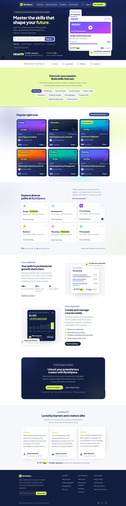

# ByteSpace

It is a responsive course marketplace landing page. It showcases expert-led courses, guided learning paths and tools for creators.



## Tech Stack

- [Next.js 16](https://nextjs.org) (App Router)
- [React 19](https://react.dev)
- [Tailwind CSS v4](https://tailwindcss.com)
- [lucide-react](https://lucide.dev) icons


## Getting Started

Install dependencies:

```bash
npm install
```

Start the development server:

```bash
npm run dev
```

Open [http://localhost:3000](http://localhost:3000) in your browser.


